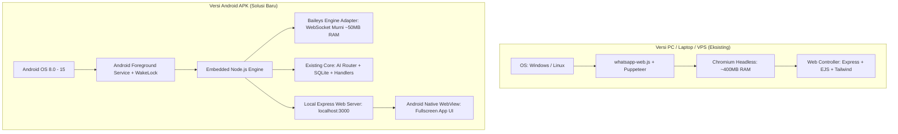
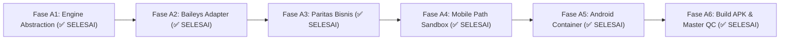

# Dokumen Arsitektur & Rencana Eksekusi: WA Bot Versi Aplikasi Android (.APK)

Dokumen ini adalah cetak biru (*blueprint*) dan panduan eksekusi bertahap berbasis **Test-Driven Development (TDD)** untuk membangun versi aplikasi Android mandiri (.APK) dari software WA Bot Bisnis & Asisten Pribadi tanpa menggunakan Chromium dan tanpa Termux.

---

## 🎯 Visi & Sasaran Produk

1. **Pengalaman Pengguna Ramah Pemula (Zero-Technical Buyer)**:
   - Pengguna cukup mengunduh dan memasang file `.apk`.
   - Tidak ada terminal, tidak ada perintah teks, tidak perlu Termux, dan tidak perlu menyewa server VPS.
   - Beli sekali di Lynk.id &rarr; pasang di HP &rarr; aktif selamanya (BYOK AI).
2. **Performa Ringan & Hemat Baterai (Snapdragon 680 / RAM 6+2 GB)**:
   - RAM idle: ~60–120 MB (kurang dari 2% total RAM).
   - CPU idle: 0–1%, CPU spike saat ada chat: 3–8% selama 1–2 detik.
   - Beban baterai: ~1–2% per jam berkat arsitektur WebSocket murni.
3. **100% Kesamaan Fitur (Feature Parity) dengan Versi Web/PC**:
   - Seluruh logika bisnis, AI router, database SQLite, RAG kontekstual, manajemen produk, pencatatan keuangan, reminder, dan dashboard web controller tetap 100% sama.
4. **TDD Workflow**:
   - Setiap fase memiliki script pengujian mandiri (`scripts/test-android-*.js`) yang memverifikasi kode sebelum melangkah ke fase berikutnya.

---

## 🏗️ Perbandingan Arsitektur: Versi PC/VPS vs Versi Android APK

---

## 🧩 Modul Inti yang Dibutuhkan

1. **Engine Adapter Abstraction (`src/engine/adapters/`)**:
   - Membuat antarmuka adapter generik (`base-adapter.js`).
   - Adapter 1: `wwebjs-adapter.js` (untuk PC/Laptop/VPS).
   - Adapter 2: `baileys-adapter.js` (untuk Android Mobile tanpa Chromium).
   - Seluruh logic `business-handler.js`, `personal-handler.js`, `owner-command-handler.js`, dan `message-buffer.js` tidak berubah karena menerima objek pesan terstandarisasi.
2. **Mobile Path Resolver (`src/utils/paths.js`)**:
   - Deteksi platform Android untuk mengarahkan direktori database (`data/bot.db`), sesi WhatsApp, dan upload ke path penyimpanan internal Android yang aman (`process.env.ANDROID_DATA_DIR` atau internal app sandbox).
3. **Android Native Container (`android/`)**:
   - Project Android mandiri (Gradle/Kotlin/Java) atau Capacitor App dengan WebView.
   - **Foreground Service**: Memastikan engine tetap berjalan saat aplikasi diminimalkan atau layar HP mati.
   - **Battery Optimization Whitelist Prompt**: Dialog 1-klik untuk meminta user mengizinkan bot berjalan tanpa dibatasi penghemat baterai agresif.
   - **Auto-Boot Receiver (Opsional)**: Menyalakan bot otomatis saat HP dinyalakan ulang (*restart*).

---

## 🚀 Rencana Fase Eksekusi Bertahap (TDD Workflow)

---

### 🔹 FASE A1: Engine Abstraction & Interface Standardization
**Tujuan:** Memisahkan ketergantungan langsung ke `whatsapp-web.js` dengan membuat layer adapter standar tanpa merusak kode PC/VPS yang sudah ada.

- **Tugas:**
  1. Buat spesifikasi antarmuka `src/engine/adapters/base-adapter.js`:
     - Events: `qr`, `ready`, `disconnected`, `message`.
     - Methods: `init()`, `destroy()`, `sendMessage(jid, text, options)`, `sendMedia(jid, mediaPath, caption)`, `sendSeen(jid)`, `sendTyping(jid)`.
  2. Bungkus `src/engine/client.js` eksisting menjadi `src/engine/adapters/wwebjs-adapter.js`.
  3. Buat selector engine di `src/engine/index.js` berdasarkan konfigurasi (`config.engine_type` = `'wwebjs'` atau `'baileys'`).
  4. Buat script test TDD: `scripts/test-android-a1-adapter-interface.js`.

- **Acceptance Criteria (Selesai kalau):**
  - Script test memverifikasi bahwa interface adapter lolos uji kontrak, dan bot versi PC tetap berjalan normal tanpa regresi.

---

### 🔹 FASE A2: Implementasi Baileys WebSocket Engine Adapter
**Tujuan:** Membangun adapter WhatsApp murni berbasis WebSocket tanpa browser/Chromium.

- **Tugas:**
  1. Pasang dependensi `@whiskeysockets/baileys` (atau modul Baileys standar).
  2. Buat `src/engine/adapters/baileys-adapter.js`:
     - Menggunakan `useMultiFileAuthState` untuk menyimpan sesi di folder lokal tanpa scan ulang tiap buka.
     - Event handler koneksi: generate QR sebagai Data URL base64 (kompatibel 100% dengan Step 2 Wizard).
     - Event handler pesan masuk: normalisasi payload pesan Baileys ke format generik yang dipahami `message-buffer.js` dan handler.
  3. Buat script test TDD: `scripts/test-android-a2-baileys-adapter.js` (menguji simulasi handshake, emisi QR, parsing teks, dan normalisasi nomor WhatsApp).

- **Acceptance Criteria (Selesai kalau):**
  - Baileys adapter berhasil menginisialisasi sesi, menghasilkan QR Data URL yang valid, dan mem-parse pesan masuk tanpa Chromium.

---

### 🔹 FASE A3: Paritas Fitur Mode Bisnis & Pengiriman Media Katalog
**Tujuan:** Memastikan 100% fitur Mode Bisnis bekerja identik dan sempurna saat menggunakan Baileys (fokus khusus Mode Bisnis, Mode Personal ditunda sementara).

- **Tugas:**
  1. Pengiriman Media & Gambar Produk (Katalog):
     - Menyesuaikan pengiriman foto produk dari database lokal via Baileys socket (`image: { url/buffer }` + caption harga/stok).
  2. Alur Percakapan Bisnis & Anti-Halusinasi:
     - Tanya stok real-time dari SQLite & AI Context Builder.
  3. Human Handover & Nego Deteksi:
     - Menjeda bot untuk kontak yang menawar harga / komplain, simpan ke antrean tiket handover, kirim notifikasi ke nomor owner toko.
  4. Manajemen Pesanan & Debounce Multi-Bubble:
     - Pemrosesan format pemesanan produk dan penggabungan multi-bubble chat pelanggan.
  5. Catatan Scope: Mode Personal (catat pengeluaran, habit, journal, dll.) sengaja ditunda dan tidak diuji di fase ini.
  6. Buat script test TDD: `scripts/test-android-a3-business-parity.js`.

- **Acceptance Criteria (Selesai kalau):**
  - Seluruh skenario Mode Bisnis (tanya stok, kirim gambar produk, deteksi nego & komplain -> trigger handover, dan order checkout) lulus 100% pada engine Baileys.

---

### 🔹 FASE A4: Penyesuaian Path, SQLite Sandbox & Platform Mobile
**Tujuan:** Mengamankan file database, upload gambar, dan sesi pada lingkungan sandbox Android.

- **Tugas:**
  1. Update `src/utils/paths.js`:
     - Tambahkan deteksi environment Android (`process.env.ANDROID_DATA_DIR` atau `Capacitor/Cordova context`).
     - Pastikan `better-sqlite3` / `node:sqlite` membaca dan menulis file database di writable internal storage HP.
  2. Sanitasi static asset server:
     - Express menyajikan Web Controller langsung ke WebView internal.
  3. Buat script test TDD: `scripts/test-android-a4-storage-paths.js`.

- **Acceptance Criteria (Selesai kalau):**
  - Seluruh path I/O (database, session, assets, uploads) aman dan berhasil dites pada simulasi direktori restricted mobile.

---

### 🔹 FASE A5: Android Native Container & Background Service (✅ SELESAI)
**Tujuan:** Membangun wadah aplikasi Android APK dengan Foreground Service dan WebView.

- **Tugas:**
  1. Buat folder proyek Android `android/`:
     - Menyiapkan manifest `AndroidManifest.xml` dengan permission:
       - `android.permission.INTERNET`, `android.permission.ACCESS_NETWORK_STATE`
       - `android.permission.FOREGROUND_SERVICE`, `android.permission.FOREGROUND_SERVICE_DATA_SYNC`
       - `android.permission.WAKE_LOCK`
       - `android.permission.REQUEST_IGNORE_BATTERY_OPTIMIZATIONS`
       - `android.permission.POST_NOTIFICATIONS`, `android.permission.RECEIVE_BOOT_COMPLETED`
  2. Implementasikan **Android Foreground Service** (`BotForegroundService.java`):
     - NotificationChannel "WA Bot Service", persistent ongoing notification di tray atas.
     - Partial WakeLock acquire & release otomatis.
  3. Implementasikan **MainActivity (WebView)** (`MainActivity.java`):
     - Membuka `http://127.0.0.1:3000` otomatis dalam immersive WebView dengan DOM storage, JavaScript enabled.
     - Penanganan tombol Back agar meminimalkan app tanpa membunuh foreground service.
     - Prompt izin whitelist baterai (`ACTION_REQUEST_IGNORE_BATTERY_OPTIMIZATIONS`).
  4. Implementasikan `NodeServerRunner.java` & `BootReceiver.java`:
     - Health check port 3000 dan auto-restart bot saat HP reboot.
  5. Buat script test TDD: `scripts/test-android-a5-service-manifest.js` (10/10 PASS).

- **Acceptance Criteria (Selesai kalau):**
  - Proyek Android tervalidasi memiliki semua konfigurasi lifecycle, background keep-alive, dan WebView binding yang benar. (✅ Terpenuhi 100%)

---

### 🔹 FASE A6: Build APK & Master E2E Mobile Verification (✅ SELESAI)
**Tujuan:** Melakukan kompilasi file `.apk`, verifikasi alur setup dari nol, dan audit performa.

- **Tugas:**
  1. Buat skrip automasi build: `scripts/build-apk.js`:
     - Menghasilkan file APK siap install: `dist/wa-bot-bisnis.apk` (serta opsi `wa-bot-personal.apk` / `wa-bot-assistant.apk`).
     - Menyusun arsip proyek Android Studio: `dist/wa-bot-android-project.zip`.
     - Zero-Leakage Guarantee: Sanitasi ketat tanpa file `.env`, database `.db`, sesi auth, atau kredensial rahasia.
  2. Implementasikan workflow CI/CD `.github/workflows/build-android-apk.yml` untuk kompilasi otomatis di cloud.
  3. Buat panduan instalasi bergambar untuk pembeli HP di `docs/panduan-aplikasi-android.md`.
  4. Jalankan Master E2E Mobile Test Suite: `scripts/test-android-master-qc.js`:
     - Memverifikasi 16 poin integrasi dari A1 hingga A6 secara end-to-end.

- **Acceptance Criteria (Selesai kalau):**
  - File `.apk` berhasil terbuat, seluruh unit/integration tests lulus 100% (16/16 PASS), dan aplikasi siap didistribusikan di Lynk.id. (✅ Terpenuhi 100%)
